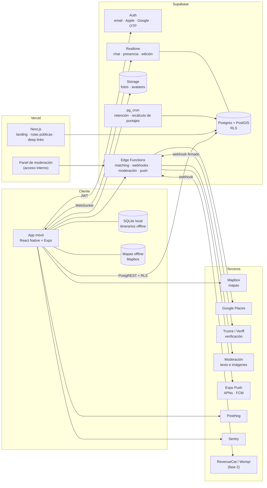
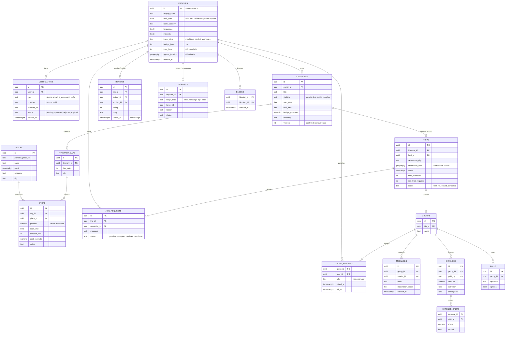

# 04 · Arquitectura técnica

**Responsable:** desarrollo (arquitectura de software) · **Insumos:** `docs/brief.md` (4 pilares: Planea, Coincide, Viajen juntos, Confianza).
**Principio rector:** construir rápido con piezas administradas que Lumen Studio ya domina (Supabase y Vercel), con privacidad y seguridad desde el diseño, y sin atarnos a servicios caros antes de validar el producto.

> **Nota sobre precios:** ninguna cifra de este documento es un precio garantizado. Cada costo remite a la página oficial de precios del proveedor y debe verificarse al contratar; los rangos son **estimaciones** con supuestos explícitos.

---

## 1. Stack recomendado

| Capa | Recomendación | Por qué |
| --- | --- | --- |
| App móvil | **React Native + Expo (SDK actual, New Architecture) + TypeScript** | Un solo código para iOS y Android; el equipo de Lumen ya trabaja en React/TypeScript para web (curva mínima); EAS resuelve builds, firmas y actualizaciones OTA; ecosistema maduro para mapas, notificaciones y almacenamiento local. Flutter es igual de capaz, pero obligaría a aprender Dart y a duplicar lógica con la web. |
| Navegación y estado | Expo Router · TanStack Query (caché de servidor) · Zustand (estado local) | Patrones conocidos, buen soporte offline con persistencia de la caché. |
| Backend | **Supabase**: Postgres + **PostGIS**, Auth, Realtime, Storage, Edge Functions, `pg_cron` | Ventaja directa: Lumen ya lo usa. Postgres con RLS concentra la seguridad en la base; PostGIS resuelve búsquedas por cercanía; Realtime cubre chat y edición colaborativa; Edge Functions para lógica con secretos (webhooks de pagos, verificación, moderación). |
| Web complementaria | **Vercel** (Next.js): landing, páginas públicas de rutas/plantillas compartibles (SEO y enlaces profundos), panel interno de moderación | Lumen ya despliega allí; las páginas públicas de itinerarios son un canal de adquisición. |
| Mapas | **Mapbox** (SDK `@rnmapbox/maps`) para render de mapas y rutas; mapas offline por región | Estilo propio acorde a la marca, mapas descargables offline y facturación por usuarios activos del SDK móvil con nivel gratuito (ver <https://www.mapbox.com/pricing>). |
| Lugares (POI) | **Google Places API (New)** con *field masks* mínimos + caché propia en tabla `places` | Mejor cobertura y calidad de datos de lugares en LatAm. Para controlar costo: autocompletado con *session tokens*, pedir solo campos básicos, guardar `place_id` y datos permitidos por sus términos, y reutilizar. Precios por SKU en <https://developers.google.com/maps/billing-and-pricing/pricing>. Alternativa de respaldo: Mapbox Search / Foursquare Places si el costo se dispara. |
| Chat en tiempo real | **Supabase Realtime** (Postgres Changes + Broadcast + Presence) sobre tabla `messages` | Sin proveedor extra en MVP. Si el volumen de conexiones lo exige (etapa 100k), evaluar Stream Chat o un servicio dedicado; la tabla de mensajes queda como fuente de verdad. |
| Notificaciones push | **Expo Push Service** (sobre APNs/FCM), disparado desde Edge Functions / triggers | Gratuito y simple; migrable a FCM/APNs directo sin cambiar la app. |
| Pagos | **MVP: sin cobros dentro de la app**; la división de gastos es un registro (no mueve dinero). Fase 2: suscripción premium vía **RevenueCat** (compras in-app de Apple/Google, obligatorias para contenido digital) y, si hay servicios presenciales o reservas, **Wompi** o **Mercado Pago** para Colombia (PSE, Nequi, tarjetas) o **Stripe** para clientes internacionales. | Mover dinero entre usuarios implica obligaciones regulatorias (SFC en Colombia) y riesgo de fraude; no aporta a validar el núcleo. Liquidación de deudas: enlaces a Nequi/Daviplata/PayPal fuera de la app. |
| Verificación de identidad | **Truora** (Colombia/LatAm: documento + selfie con prueba de vida, validación contra fuentes locales) como proveedor principal; **Veriff** o **Persona** para documentos extranjeros si Truora no cubre al viajero internacional | Truora tiene foco y cobertura documental en LatAm; Veriff/Persona cubren pasaportes globales. Precios por verificación bajo cotización (marcar como estimación). Se integra vía Edge Function + webhook; solo guardamos el resultado, nunca la imagen del documento. |
| Moderación | **OpenAI Moderation API** u otro clasificador equivalente para texto; **AWS Rekognition Content Moderation** o **Hive** para imágenes; listas propias de palabras y patrones (teléfonos, enlaces) | Filtro automático previo + cola humana en el panel interno (ver doc 05). |
| Analítica de producto | **PostHog** (eventos, embudos, *feature flags*, experimentos) | Nivel gratuito generoso y opción de alojamiento en la UE; un solo proveedor para flags y analítica. Sin PII en eventos. |
| Observabilidad | **Sentry** (errores y rendimiento app + Edge Functions) · logs y métricas de Supabase · alertas en Slack | Estándar en React Native; integra con EAS para *source maps*. |
| CI/CD | **GitHub Actions** (lint, tipos, tests, migraciones en rama de Supabase) + **EAS Build / Submit / Update** | Builds en la nube sin Mac propio, envío a tiendas y parches OTA para JS sin pasar por revisión. Precios en <https://expo.dev/pricing>. |
| Calidad | Vitest/Jest + React Native Testing Library; Maestro para pruebas E2E móviles; pgTAP para probar políticas RLS | Las políticas RLS son seguridad: se prueban como código. |

---

## 2. Diagrama de arquitectura



**Reglas del diagrama:** la app nunca guarda secretos de terceros; todo lo que usa una llave privada (Places, verificación, moderación, pagos) pasa por Edge Functions. La llave pública de Mapbox se restringe por *bundle id*.

---

## 3. Modelo de datos principal



**Notas de diseño**
- **Itinerario vs. viaje publicado:** el itinerario es el plan (privado por defecto); el *trip* es la publicación «busco compañeros» con fechas, cupos y requisito mínimo de confianza. Un itinerario puede existir sin publicarse.
- **Orden de paradas** con posición fraccional para reordenar sin reescribir filas y facilitar la sincronización offline.
- **Reseñas doble ciego:** se hacen visibles cuando ambas partes escriben o pasan 14 días (`visible_at`), para evitar represalias.
- **Bloqueos simétricos:** una función `is_blocked(a, b)` se usa en RLS y en matching; ni uno ni otro se ven en búsquedas, viajes ni chats nuevos.
- **Gastos en moneda original** con conversión solo de visualización (tasa diaria cacheada); los saldos se calculan con una vista.
- **Índices clave:** GiST sobre `trips.destination_area` y `trips.dates`; GIN sobre `interests` y `languages`; índice compuesto `messages(group_id, created_at)`.
- **Auditoría:** tabla `audit_log` (solo inserción) para acciones sensibles: cambios de verificación, sanciones, exportaciones y borrados.

---

## 4. Algoritmo de coincidencias (MVP)

**Etapa 1 · filtros duros** (en SQL, antes de puntuar): mismo destino (ciudad o radio de 50 km con PostGIS) · fechas que se solapan al menos 1 día · ambos mayores de 18 · sin bloqueo en ninguna dirección · confianza del candidato ≥ `min_trust_required` del viaje · preferencias explícitas del usuario (p. ej., «solo mujeres» si la política de confianza lo habilita, ver doc 05) · viaje en estado `open`.

**Etapa 2 · puntaje simple y explicable (0–100)**

```
puntaje = 100 × ( 0,30·F + 0,20·I + 0,15·E + 0,10·P + 0,10·L + 0,15·C )
```

| Señal | Cálculo (0 a 1) |
| --- | --- |
| **F** · solape de fechas | días compartidos ÷ días del viaje más corto |
| **I** · intereses | Jaccard: intereses en común ÷ intereses totales |
| **E** · estilo de viaje | 1 si igual; 0,5 si compatible (tabla de afinidad); 0 si opuesto |
| **P** · presupuesto | 1 − \|nivel A − nivel B\| ÷ 3 |
| **L** · idioma | 1 si comparten al menos un idioma; 0 si no |
| **C** · confianza | nivel de confianza del candidato ÷ 3 (teléfono, documento, reseñas positivas) |

El destino no suma: es filtro. Las razones se muestran al usuario («Coinciden 5 días · 3 intereses en común · ambos hablan inglés · identidad verificada»), lo que da transparencia y facilita la moderación. Se calcula en una función SQL (`match_candidates(user_id, trip_id)`) con caché de 24 h en `match_scores`, recalculada por `pg_cron` y al editar perfil o viaje.

**Evolución**
1. **MVP:** pesos fijos, ajustados a mano con datos de PostHog (tasa de solicitud → aceptación → viaje realizado → reseña positiva).
2. **Post-MVP (≈10k usuarios):** pruebas A/B de pesos con *feature flags*; señales de comportamiento (lugares guardados en común, respuesta rápida, tasa de aceptación) y penalización por reportes.
3. **Escala (≈100k):** modelo de aprendizaje de *ranking* (p. ej., regresión logística o *gradient boosting*) entrenado con el resultado «viaje completado con reseña ≥ 4», manteniendo las razones visibles; embeddings de intereses y descripciones con `pgvector`. La confianza nunca se compra: los planes pagos no alteran el puntaje de seguridad.

---

## 5. Privacidad y seguridad técnica

**Ubicación aproximada.** Nunca se guarda ni se muestra la posición exacta de otra persona. La app envía como máximo la ciudad o una celda difuminada: coordenadas redondeadas a una celda H3 de resolución ~7 (aprox. 5 km²) más un desplazamiento aleatorio estable por usuario; la «cercanía» se muestra como «en Medellín» o «a menos de 5 km». La ubicación precisa solo se usa en el dispositivo (mapa propio, navegación) y en el **botón de seguridad**, donde se comparte en vivo y por tiempo limitado con contactos de confianza elegidos, con caducidad automática.

**Control de acceso (RLS en todas las tablas).** Política por defecto: denegar. Ejemplos: un perfil público expone solo una vista (`public_profiles`) sin fecha de nacimiento ni correo; mensajes y gastos solo para `group_members` activos; solicitudes visibles para quien las envía y el anfitrión; `verifications` solo lectura del propio usuario y escritura exclusiva de la Edge Function del proveedor (rol de servicio). Las políticas se prueban con pgTAP en CI. La llave `service_role` nunca sale de Edge Functions.

**Autenticación.** Apple, Google, correo con enlace mágico y OTP por SMS para verificar teléfono; sesiones cortas con *refresh token* rotativo; bloqueo y *rate limiting* en Edge Functions para evitar enumeración y spam; detección de cuentas múltiples por dispositivo y teléfono.

**Cifrado.** TLS 1.2+ en tránsito; cifrado en reposo del proveedor (Supabase/AWS); columnas especialmente sensibles (teléfono, referencias de verificación) cifradas con `pgsodium`/Vault; tokens locales en Keychain/Keystore (`expo-secure-store`). El chat no es E2E en el MVP para permitir moderación ante reportes; se informa con claridad en la política de privacidad.

**Verificación de identidad.** Imágenes de documento y selfie quedan en el proveedor (Truora/Veriff) con su retención; nosotros guardamos solo estado, fecha, tipo y referencia. Edad mínima **18 años**: fecha de nacimiento declarada en el registro y confirmada con el documento al verificar; las cuentas no verificadas tienen funciones limitadas (no pueden publicar viajes ni unirse a grupos, según doc 05).

**Moderación automática.** Todo texto público (bio, viajes, reseñas) y los mensajes pasan por un clasificador antes o justo después de publicarse; las imágenes se analizan al subir (Edge Function sobre Storage) y quedan en cuarentena si superan el umbral. Detección de patrones de riesgo: solicitudes de dinero, enlaces externos, datos de contacto en los primeros mensajes. Lo dudoso va a la cola humana del panel interno. Metadatos EXIF (incluida la ubicación GPS) se eliminan de toda foto subida.

**Retención de datos (propuesta).**

| Dato | Retención |
| --- | --- |
| Cuenta borrada | Borrado lógico inmediato, anonimización a los 30 días |
| Mensajes de grupo | Mientras exista el grupo; se borran 12 meses después del fin del viaje, salvo los vinculados a un reporte abierto |
| Ubicación en vivo (botón de seguridad) | 72 h |
| Reportes y sanciones | 3 años (prevención de reincidencia, defensa legal) |
| Logs técnicos | 30–90 días |
| Resultado de verificación | Mientras la cuenta esté activa |

**Cumplimiento.**
- **Ley 1581 de 2012 y Decreto 1377 de 2013 (Colombia):** autorización previa, expresa e informada con registro de la versión aceptada (`consents`); política de tratamiento publicada; atención de consultas y reclamos (derechos de conocer, actualizar, rectificar y suprimir) en los plazos de ley, con autoservicio en la app (exportar y borrar cuenta); inscripción en el Registro Nacional de Bases de Datos ante la SIC si aplica por tamaño (verificar con asesoría legal); transferencia internacional informada (servidores fuera de Colombia).
- **GDPR (viajeros europeos):** base legal por tratamiento, minimización, portabilidad, derecho al olvido, DPA firmados con cada proveedor (Supabase, PostHog, Sentry, Truora/Veriff), región de datos documentada y evaluación de impacto (DPIA) por tratar datos de verificación y ubicación.
- **Tiendas:** etiquetas de privacidad de Apple/Google, borrado de cuenta dentro de la app (requisito de Apple), cumplimiento de políticas de contenido generado por usuarios (reportar y bloquear).

---

## 6. Funcionamiento sin conexión y rendimiento

**Offline primero para el itinerario.** El viajero suele perder señal justo cuando más necesita el plan.
- Al marcar un viaje como «disponible sin conexión», la app descarga a **SQLite local** (`expo-sqlite` con una capa de sincronización como PowerSync o una cola propia) el itinerario, días, paradas, lugares, gastos y los últimos mensajes; y descarga la **región del mapa** con el gestor offline de Mapbox (zona acotada y niveles de zoom limitados para cuidar espacio).
- Ediciones sin conexión se guardan como operaciones en cola y se sincronizan al volver la señal. Resolución de conflictos: *last-write-wins* por campo con `version` y `updated_at`; reordenamiento sin choques gracias a la posición fraccional; gastos y mensajes solo se agregan, así que no chocan.
- Indicador visible de estado: «Sincronizado», «Pendiente», «Sin conexión».

**Rendimiento.**
- Objetivos: arranque en frío < 2,5 s en Android de gama media; 60 fps en mapa y listas; consultas de matching < 300 ms en el p95.
- Hermes, listas virtualizadas (FlashList), imágenes con `expo-image` y miniaturas generadas en Storage (transformaciones), *clustering* de marcadores en el mapa.
- Paginación por cursor en chat y feeds; caché de lugares para reducir llamadas a Places (también baja costos).
- Presupuesto de datos móviles: imágenes WebP comprimidas, *lazy loading* y modo «ahorro de datos».

---

## 7. Plan de construcción del MVP

**Alcance:** los 4 pilares en su versión mínima, definida en el doc 02 (producto). Sprints de 2 semanas; total estimado **7 sprints (~14 semanas)** más una ventana de revisión en tiendas.

| Sprint | Objetivo | Entregables |
| --- | --- | --- |
| 0 | Cimientos | Repos, monorepo (app + web), Supabase (entornos dev/staging/prod), CI, EAS, Sentry, PostHog, sistema de diseño base en código |
| 1 | Cuenta y perfil | Registro (Apple/Google/correo), verificación de teléfono, perfil con intereses/estilo/idiomas, consentimientos, borrado y exportación de cuenta |
| 2 | Planea I | Crear itinerario por días, buscar lugares (Places + caché), mapa con paradas, reordenar |
| 3 | Planea II + offline | Presupuesto por parada, plantillas públicas, modo sin conexión, página pública compartible en Vercel |
| 4 | Coincide | Publicar viaje, filtros + puntaje de matching con razones, solicitudes de unión, notificaciones push |
| 5 | Viajen juntos | Grupo automático al aceptar, chat en tiempo real, votaciones, división de gastos y saldos |
| 6 | Confianza | Verificación de identidad (Truora/Veriff), niveles de confianza, reportar/bloquear, moderación automática, panel interno, botón de seguridad, reseñas doble ciego |
| 7 | Endurecimiento y lanzamiento | Pruebas E2E, auditoría RLS y de seguridad, rendimiento, beta cerrada (TestFlight / prueba interna), envío a tiendas |

**Equipo recomendado (MVP)**
- 1 líder técnico / arquitecto (backend Supabase, seguridad, revisiones).
- 2 desarrolladores React Native (uno con experiencia en mapas y offline).
- 1 diseñador UX/UI (medio tiempo desde el sprint 2).
- 1 QA (medio tiempo desde el sprint 3; automatización E2E).
- 1 product manager (puede ser el dueño de producto de Lumen).
- Apoyo puntual: asesoría legal en datos personales y un moderador de contenido al abrir la beta.

**Costos de infraestructura mensuales (estimación)**

*Supuestos comunes:* usuarios registrados; ~25–35 % activos mensuales; cada activo hace pocas búsquedas de lugares (con caché); verificación de identidad solo para quien publica o se une a viajes; sin pagos dentro de la app en MVP. Los rangos dependen de precios vigentes y de cotizaciones; **verificar siempre en las páginas oficiales**.

| Concepto | MVP / beta (≤ 1k usuarios) | 10k usuarios | 100k usuarios | Fuente de precios |
| --- | --- | --- | --- | --- |
| Supabase | Plan Pro (cuota fija publicada) | Pro + uso adicional (cómputo mayor, Realtime, egress) | Pro/Team con cómputo dedicado y réplica de lectura | <https://supabase.com/pricing> |
| Vercel | Plan que Lumen ya tiene (posible costo marginal ≈ 0) | Pro | Pro + uso | <https://vercel.com/pricing> |
| Mapbox | Dentro del nivel gratuito por MAU del SDK móvil (estimación) | Probablemente cerca o dentro del nivel gratuito | Pago por MAU por encima del umbral | <https://www.mapbox.com/pricing> |
| Google Places | Cubierto por créditos/umbral gratuito mensual (estimación) | Variable según búsquedas; principal costo a vigilar | Alto si no hay caché; negociar o migrar parte a otro proveedor | <https://developers.google.com/maps/billing-and-pricing/pricing> |
| Verificación de identidad | Pago por verificación, bajo cotización | Escala con verificaciones (supuesto: 20–40 % de usuarios) | Negociar volumen | Truora / Veriff / Persona (cotización) |
| Moderación | Nivel gratuito o muy bajo | Pago por imagen analizada | Pago por volumen | Página del proveedor elegido |
| Expo EAS | Plan gratuito o Starter | Production | Production / Enterprise | <https://expo.dev/pricing> |
| PostHog | Nivel gratuito | Nivel gratuito o bajo | Pago por eventos | <https://posthog.com/pricing> |
| Sentry | Nivel gratuito / Team | Team | Business | <https://sentry.io/pricing> |
| Push (Expo) | Sin costo | Sin costo | Sin costo (evaluar FCM/APNs directo) | <https://docs.expo.dev/push-notifications/overview/> |
| Tiendas | Cuenta Apple Developer (anual) + Google Play (pago único) | Igual | Igual | Apple / Google |
| **Rango orientativo total** | **Bajo: decenas a pocos cientos de USD/mes** | **Medio: cientos de USD/mes, dominado por Places y verificación** | **Alto: de varios miles de USD/mes; requiere optimización y negociación** | Estimación, no cotización |

**Palancas de costo:** caché agresiva de lugares y autocompletado con *session tokens*; verificación solo en el momento de valor (publicar o unirse); compresión de imágenes; alertas de presupuesto en Google Cloud, Mapbox y Supabase desde el día uno. Antes de presupuestar en firme, el gerente debe pedir cotizaciones a Truora/Veriff y simular el uso de Places con datos de la beta.

**Riesgos técnicos principales y mitigación**
1. *Costo de Places* → caché, campos mínimos, proveedor alterno listo.
2. *Escala de Realtime en chat* → medir conexiones concurrentes desde la beta; plan B con proveedor de chat dedicado.
3. *Errores en RLS* (fuga de datos) → pruebas pgTAP obligatorias en CI y revisión de seguridad antes del lanzamiento.
4. *Rechazo en tiendas* por contenido de usuarios o ubicación → reportar/bloquear, borrado de cuenta y textos de permisos claros desde el sprint 1.

---

*Diseñado por Lumen Studio.*
